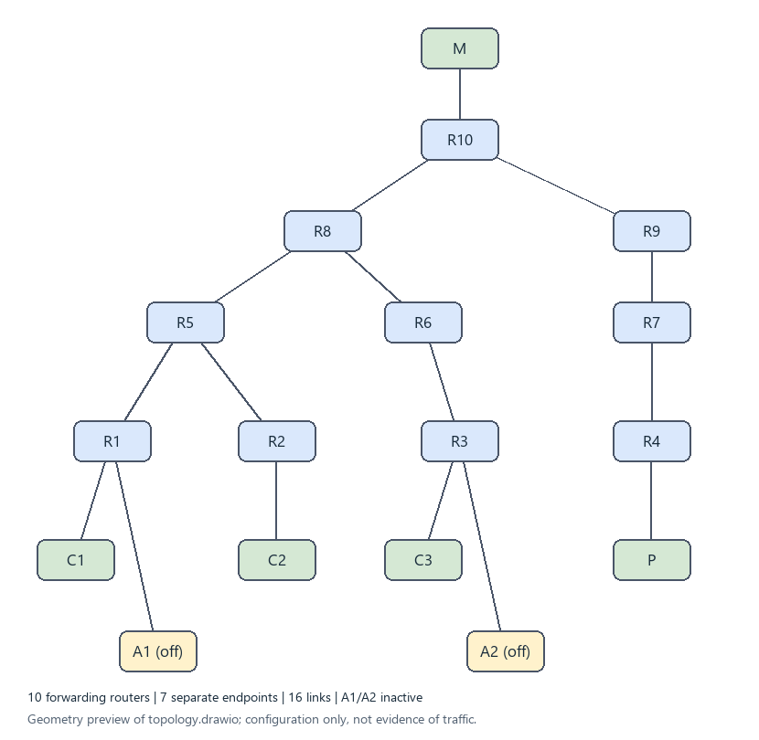

# NDN-IFA Detection: In-Band Monitoring Delivery & Centralized Detection

This repository contains the **ndnSIM** simulation code, centralized machine learning detector implementation, offline evaluation dataset, frozen model checkpoints, scenario configurations, and audited experiment summaries for **Interest Flooding Attack (IFA)** detection in Named Data Networking (NDN).

The experiments evaluate two questions on a 10-router tree topology:
1. **Monitoring Delivery & Detection Reliability (RQ1):** To what extent does a combined **strict non-preemptive priority + push-out admission** policy (compared against standard **FIFO/tail-drop** queuing) preserve timely in-band monitoring delivery under network congestion and restore centralized IFA detection performance?
2. **Service Trade-offs (RQ2):** What service cost does prioritizing monitoring traffic impose on legitimate consumer requests and background traffic sharing the bottleneck link?



---

## System Architecture & Pipeline

```text
M (Collector / Detector) -- R10
                             |-- R8 (Bottleneck: R8 -> R10 = 1 Mbps, reverse = 10 Mbps)
                             |   |-- R5
                             |   |   |-- R1 -- C1, A1
                             |   |   +-- R2 -- C2
                             |   +-- R6
                             |       +-- R3 -- C3, A2
                             +-- R9 -- R7 -- R4 -- P (Producer / Background / Attack Sink)
```

1. **Local Router Measurement (*Agent*):** Each router (`R1`..`R10`) records 11 NFD counters every 1 second (across 28 windows in a 30-second simulation): incoming/outgoing `Interest`, `Data`, and `NACK` packet deltas, `satisfied` and `unsatisfied` Interests, Content Store `hit`/`miss` deltas, and a `PIT` entry count snapshot.
2. **In-Band Report Collection (*Pull*):** Starting at `w + 50 ms` (with a 1 ms stagger per router), collector `M` at `R10` polls each router with an NDN Interest. Each router replies with an NDN Data packet that traverses the same simulated network links as service traffic.
3. **Causal Decision Cutoff:** The detector freezes observations at `d_w = w + 250 ms`. Only reports that actually arrive at `M` by `d_w` are eligible for that decision. If a router's report for window `w` has not arrived, the detector applies *Last Observation Carried Forward* (LOCF) along with a freshness indicator (`current_mask`) and sample age (`sample_age`).
4. **Centralized Inference:** Five consecutive frames form a `5 x 10 x 13` input tensor (yielding 24 decisions per run after a 4-window warm-up). Features are normalized using a train-only scaler (`configs/scaler.json`) and scored by frozen model checkpoints and thresholds. In the online campaign, `ndnsim/scenarios/rq1-online-tree.cc` streams report arrival events to `detector/detector.py` over a local UNIX datagram socket with a local output target of `w + 500 ms` (`cutoff + 250 ms`).

---

## Repository Structure

| Directory / File | Contents & Purpose |
|---|---|
| [`ndnsim/`](ndnsim/scenarios/rq1-online-tree.cc) | ndnSIM C++ scenarios (`rq1-online-tree.cc`, `ifa-tree.cpp`, `benign-tree.cpp`), `ns-3`/`ndn-cxx` compatibility & scheduler patches, and build/runner scripts (`bootstrap_mint.sh`). |
| [`detector/`](detector/README.md) | Live detector process (`detector.py`), 10 model architectures (`models.py`), experiment runner (`runner.py`), tensor verifier (`verify.py`), offline training/testing scripts (`train.py`, `test.py`), 9,216-row `npz`/`csv` dataset, and 10 frozen checkpoints (`pretrained/`). |
| [`configs/`](configs/registry.json) | Checkpoint & threshold manifest (`registry.json`), train-only normalization parameters (`scaler.json`), 720-run plan (`plan.json`), workload family definitions (`families.json`), and 72 scenario configs (`cases/`). |
| [`results/`](results/metrics-fresh-macro.csv) | Audited summary tables: macro and pooled detection metrics, per-family breakdowns, consumer service completion, per-run timing, burst diagnostics, and detector compute cost (`COMPUTE-COST.csv`). |
| [`docs/`](docs/PROTOCOL.md) | Experiment protocol (`PROTOCOL.md`) and editable/preview topology diagrams (`topology-preview.png`, `topology.drawio`). |
| [`config/`](config/README.md) | Initial portable lab package (benign and IFA pilot scenarios with SHA-256-verified reference evidence). |

Detailed documentation is split across:
* [Research Status & Experiment Details (`RESEARCH_STATUS.md`)](RESEARCH_STATUS.md)
* [Spatio-Temporal Feature Pipeline & ML Evaluation (`ML_TOPOLOGY_PIPELINE.md`)](ML_TOPOLOGY_PIPELINE.md)
* [Quick Start: Simulation & Detector Evaluation (`IFA_QUICKSTART.md`)](IFA_QUICKSTART.md)

---

## Quick Start

### 1. Offline Model Evaluation & Retraining (No ndnSIM Required)

The [`detector/`](detector/README.md) directory includes the causal 9,216-row dataset (`train`: 3,072, `validation`: 1,536, `test`: 4,608) and 10 frozen `seed 11` checkpoints. This runs on both Windows and Linux with Python 3.11+:

```bash
python -m venv .venv
source .venv/bin/activate        # Windows PowerShell: .venv\Scripts\Activate.ps1
python -m pip install -r requirements.txt

cd detector
python verify_files.py

# Evaluate the 10 frozen checkpoints on 4,608 test rows (46,080 predictions)
python test.py --models-dir pretrained --out results/test-original --reference reference/expected-original-predictions.csv

# Retrain all models using the validation-selected configurations
python train.py --models all --seeds 11 --search selected --out results/retrained
python test.py --models-dir results/retrained --out results/test-retrained
```

### 2. Building ndnSIM & Running Simulator Smoke Tests (Ubuntu 24.04 / Linux Mint 22.x)

To build the pinned `ns-3` / `ndnSIM` stack ([`ndnsim/docs/stack-lock.json`](ndnsim/docs/stack-lock.json)) and run the baseline vs. light-IFA smoke tests:

```bash
cd config/architecture/ndnsim
bash scripts/bootstrap_mint.sh

cd ifa-pilot
bash scripts/run_ifa.sh config/ifa-base-00000-s1.json
bash scripts/run_ifa.sh config/ifa-atk1-00050-s1.json
```

To run the offline integrity check on the reference lab package:

```bash
python config/architecture/scripts/verify_package.py
```

---

## Main Results Summary (720-Run Online Campaign)

The final online evaluation consists of **640 fresh evaluation runs** (16 new workload families: 4 families per background rate at 100, 200, 300, and 1500 Hz, each tested under `S2` benign-only vs. `S3` IFA attack and `FIFO` vs. `Priority` across 10 frozen models) plus **80 controlled burst-diagnosis runs** (total **720 runs / 17,280 decisions**).

### 1. Monitoring Delivery & Detection Under Heavy Congestion (`S3 / 1500 Hz`)

At 1500 Hz background load with an active IFA attack (`S3`), **FIFO/tail-drop** delivered **706/1,120 (63.04%)** monitoring reports on time, whereas **Priority + push-out** delivered **1,120/1,120 (100%)** on time.

The table below summarizes the 10 models on the 1500 Hz fresh online cohort (mean across 4 families, 1 `seed 11` checkpoint per model; the first 5 models form the paper's main comparison panel):

| Model | Role | Mean F1 (FIFO 1500 Hz) | Mean F1 (Priority 1500 Hz) | Timely Episode Detection (FIFO -> Priority) | P95 Cutoff-to-Output Latency (ms) |
|---|---|---:|---:|---:|---:|
| **Random Forest** | Paper Panel (Tabular) | 44.23% | 82.52% | 2/4 -> 4/4 | 146.95 |
| **GBDT** | Paper Panel (Boosting) | 16.67% | 96.43% | 1/4 -> 4/4 | 5.89 |
| **XGBoost** | Paper Panel (Boosting) | 27.78% | 92.08% | 2/4 -> 4/4 | 4.62 |
| **GRU** | Paper Panel (Temporal) | 20.83% | 90.18% | 2/4 -> 4/4 | 4.82 |
| **GraphSAGE+GRU** | Paper Panel (Spatio-Temporal) | 20.54% | 84.44% | 2/4 -> 4/4 | 7.05 |
| Logistic Regression | Extended Comparator | 12.50% | 90.18% | 1/4 -> 4/4 | 3.73 |
| HistGB | Extended Comparator | 48.97% | 90.18% | 2/4 -> 4/4 | 27.96 |
| AdaBoost | Extended Comparator | 16.67% | 77.08% | 1/4 -> 4/4 | 92.78 |
| LightGBM | Extended Comparator | 46.75% | 85.59% | 2/4 -> 4/4 | 6.43 |
| CatBoost | Extended Comparator | 19.23% | 85.59% | 2/4 -> 4/4 | 9.40 |

* Full per-family and per-rate metrics (100, 200, 300, 1500 Hz) are available in [`results/metrics-fresh-macro.csv`](results/metrics-fresh-macro.csv) and [`results/metrics-per-family.csv`](results/metrics-per-family.csv).
* Detector compute and memory measurements are recorded in [`results/COMPUTE-COST.csv`](results/COMPUTE-COST.csv). All 17,280 online decisions finished within the 250 ms post-cutoff target (maximum 181.09 ms on Random Forest, 0 IPC drops).

### 2. Service Trade-offs & Scope Boundaries

* **Impact on Service Traffic:** On `S3 / 1500 Hz`, **Priority + push-out** reduced delivered background Data packets from 14,117 to 14,056 (**-0.432% relative**), while regular consumer completion (`C1`..`C3`) remained low due to the attack (**31.74% -> 32.17%**). Protecting monitoring traffic restores detector visibility, not normal user service, because no attack mitigation or rate-limiting is deployed.
* **Benign-Burst False Positives:** In the 80 paired burst-diagnosis runs ([`results/burst-pairs.csv`](results/burst-pairs.csv)), disabling the legitimate user burst flow (`B1`) eliminated two post-attack false alarms and raised F1 on that case from 75% to 100% across nine models. Even with 100% on-time telemetry (50/50 router-frames), legitimate traffic bursts under congestion can still trigger false alarms.
* **Claim Scope:** The tested priority mechanism combines strict non-preemptive scheduling and push-out admission (their individual effects are not isolated). Results on this 10-router tree topology with `n = 4` families per rate and a single `seed 11` checkpoint per model represent a controlled empirical evaluation rather than a universal ranking of algorithms or a hard real-time hardware guarantee.

---

## Reference Environment

* **Experiment Host:** Linux Mint 22.2 (Ubuntu 24.04 base), ThinkPad X270, Intel Core i5-7300U (2C/4T), 16 GB RAM (CPU-only inference, 2 numerical threads).
* **Simulator Stack ([`ndnsim/docs/stack-lock.json`](ndnsim/docs/stack-lock.json)):**
  * `ns-3-dev-ndnSIM`: `1b3bab9b6dba5f1e616c0b286eb889e9ce3d5d59`
  * `ndnSIM`: `90d50396654dabad54b6979f2dc8fa929ade544c` (`ndnSIM-2.9-NFD-22.02`)
  * `NFD`: `361b381b9b552ff3341aa160858bea1d470d2122`
  * `ndn-cxx`: `2b51e5796415b5d41fe268b35250b9453f16d3d6`
* **Python Stack ([`requirements-original.txt`](requirements-original.txt)):** Python 3.12.3, NumPy 2.5.4, scikit-learn 1.9.1, PyTorch 2.14.1+cpu, XGBoost 3.4.1, LightGBM 4.7.0, CatBoost 1.2.10.
