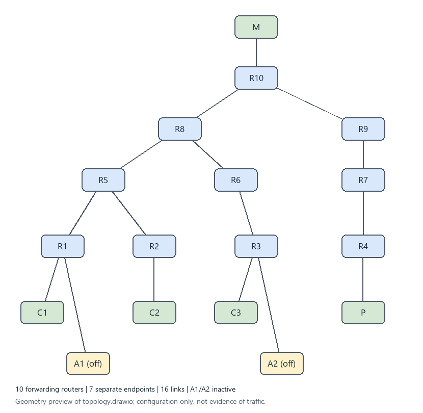
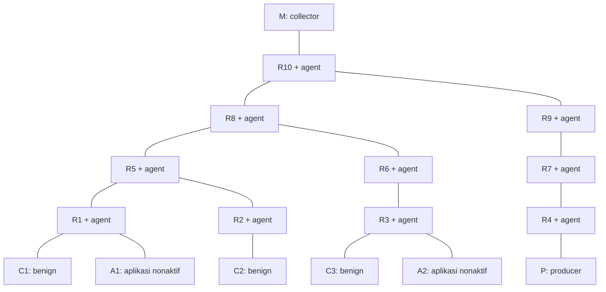
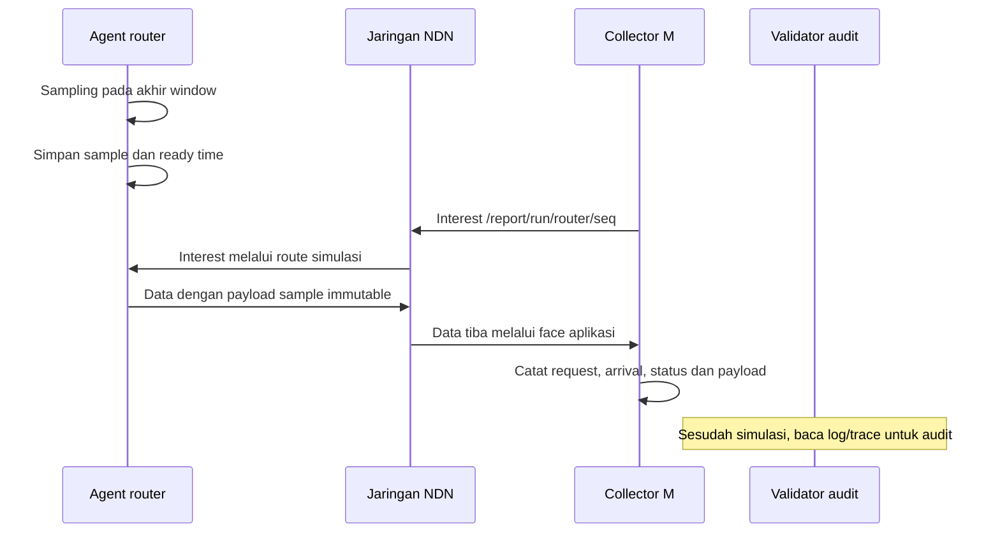
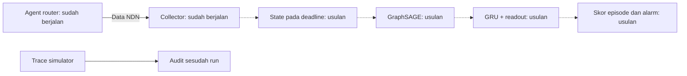

# 1. Arsitektur jaringan, pengukuran dan deteksi

## 1.1 Tujuan dan pemisahan lapisan

Arsitektur memisahkan forwarding NDN, pengukuran lokal, transport report, dan analisis deteksi. Pemisahan ini memungkinkan pengujian apakah keputusan tepat waktu masih dapat dibuat dari report yang benar-benar tersedia. Tahap yang sudah berjalan adalah forwarding dan transport pengukuran. Analisis GraphSAGE+GRU masih rancangan.

Jaringan fisik memiliki 17 node. Representasi graf untuk model kelak hanya memiliki sepuluh node router. Endpoint aplikasi tidak dimasukkan sebagai node ML hanya karena memiliki NDN stack untuk berkomunikasi.

## 1.2 Topologi fisik yang diimplementasikan



[Diagram editable diagrams.net](diagrams/topology.drawio). Gambar berasal dari geometri konfigurasi yang sama; validasi trafik dilakukan melalui trace, bukan melalui gambar.



| Jenis | Node/link |
|---|---|
| Forwarding router | R1, R2, R3, R4, R5, R6, R7, R8, R9, R10 |
| Link router | R10-R8, R10-R9, R8-R5, R8-R6, R5-R1, R5-R2, R6-R3, R9-R7, R7-R4 |
| Consumer | C1-R1, C2-R2, C3-R3 |
| Producer | P-R4 |
| Collector | M-R10 |
| Endpoint attacker | A1-R1, A2-R3, tanpa aplikasi pada pilot |

Semua R adalah router, termasuk R4 yang terhubung ke P. Producer tidak menggantikan R4. Tidak ada link R5-R6. Node dan pemetaan face runtime dapat diperiksa di [nodes.csv](evidence/reference-run/nodes.csv) dan [links.csv](evidence/reference-run/links.csv).

## 1.3 Peran komponen

| Komponen | Tugas | Sumber input |
|---|---|---|
| Forwarder router | Meneruskan Interest/Data dengan FIB/PIT/CS stack NFD | Paket pada face |
| Agent router | Sampling counter lokal dan menyimpan report immutable | Counter NFD router tempat agent berjalan |
| Producer P | Menjawab Interest benign dengan payload 512 byte | Interest benign yang mencapai aplikasi |
| Consumer C1-C3 | Mengirim nama unik dan mencatat Data/NACK/timeout | Paket aplikasi dan timer lokal |
| Collector M | Pull report, mencatat request/arrival/status | Payload Data report yang tiba |
| Validator audit | Memeriksa hasil setelah simulasi | Raw trace dan log tersimpan |
| Detektor terpusat | Kelak membentuk state observasi, graf, skor dan alarm | Hanya report yang sudah diterima, belum diimplementasikan |

Agent bukan classifier ML terpisah pada setiap router. Collector saat ini juga belum melakukan inferensi. File tracer tidak dibaca collector dan tidak menjadi jalan alternatif ketika report terlambat.

## 1.4 Alur report yang sudah berjalan



Nama report memuat run ID, router ID dan sequence. Interest menggunakan exact-name, MustBeFresh, lifetime 1 detik dan tanpa retransmission. Data memakai freshness 1000 ms; CS memiliki kapasitas 0 pada semua node. Karena nama unik dan cache nonaktif, setiap report yang dipakai M dapat dicocokkan dengan balasan agent yang bersangkutan. Pilihan ini menyederhanakan audit; bukan klaim bahwa cache harus selalu dimatikan pada penelitian NDN.

Agent menghasilkan sample setiap 1 detik. M meminta setiap router setelah akhir window +50 ms, dengan stagger 1 ms antarpoll. Deadline pilot diukur dari akhir window, bukan dari waktu request. Semua angka itu parameter pilot yang dapat berubah melalui protokol yang direncanakan, bukan nilai standar dari paper.

## 1.5 Jalur trafik dan posisi M

Contoh Interest benign C1 menuju P:

```text
C1 -> R1 -> R5 -> R8 -> R10 -> R9 -> R7 -> R4 -> P
```

Data kembali melalui PIT pada arah sebaliknya. Contoh report R1 menuju M:

```text
Poll Interest: M -> R10 -> R8 -> R5 -> R1
Report Data:   R1 -> R5 -> R8 -> R10 -> M
```

Analisis graf statis memberi jarak report rata-rata 3 hop dan maksimum 4 hop termasuk link M. Di antara posisi collector pada sepuluh router, R10 meminimalkan maksimum hop; R8 meminimalkan jumlah hop, dengan rata-rata 2.8 dan maksimum 5. Ini dua objektif berbeda. Perhitungan hop tidak membuktikan minimum delay ketika antrean dan trafik hadir.

Enam jalur report, dari R1/R2/R3/R5/R6/R8, melintasi R8 ke R10. Jalur hipotetis A1/A2 menuju P juga melewati koridor itu. Hubungan jalur ini belum merupakan bukti congestion atau serangan; attacker nonaktif pada run acuan. Cabang R9-R7-R4 membawa trafik menuju producer dan bukan cabang kontrol bebas serangan. Jalankan [analisis graf](scripts/analyze_topology.py) untuk menghitung ulang semua jalur.

## 1.6 Alur deteksi yang direncanakan



Panah putus-putus menandai komponen yang belum tersedia dalam source. Usulan menggabungkan hubungan spasial router dan history kausal, tetapi manfaatnya harus ditunjukkan terhadap baseline graf snapshot dan non-graf. Penjelasan lengkap tersedia pada [kontrak detektor](04-kontrak-detektor.md).
